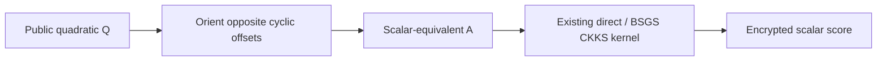
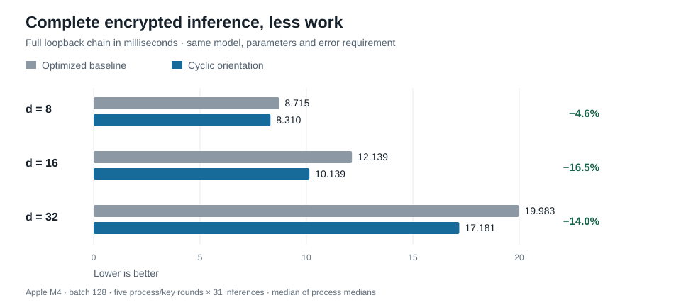

# Terminal-Scalar-Aware Compilation of Quadratic Scores for CKKS

[](https://doi.org/10.5281/zenodo.23474352)
[](https://github.com/LeonardSEO/fhe-quadratic-ckks/actions/workflows/verify.yml)
[](lean/lean-toolchain)
[](LICENSE)
[](LICENSES/CC-BY-4.0.txt)

**An exact compiler transformation that reduces the cost of encrypted scalar quadratic inference.** We preserve the final score while changing the intermediate linear map, prove the construction's optimal cyclic-diagonal support, and demonstrate lower inference time and server memory in actual CKKS execution.

**[Read the paper](paper.pdf) · [Download v1.0.0](https://github.com/LeonardSEO/fhe-quadratic-ckks/releases/tag/v1.0.0) · [Reproduce the results](REPRODUCING.md) · [Checked Lean proofs](docs/FORMAL_VERIFICATION.md)**

Leonard van Hemert · [Research artifact DOI](https://doi.org/10.5281/zenodo.23474352)

## The compiler rule

For a public scalar score

$$f(x)=x^\top Qx+\ell^\top x+c,$$

computing the full vector `Qx` preserves more information than its final scalar consumer needs. We instead choose a matrix `A` satisfying **`A + Aᵀ = 2Q`**. This preserves `f(x)` exactly while allowing a cheaper matrix to enter the existing CKKS linear-transform evaluator.



The construction retains one of each pair of opposite cyclic offsets and doubles its coefficients. Zero and the even-dimensional half-turn remain undoubled. It applies when the intermediate linear map is consumed only by the terminal scalar contraction.

## What we proved

The paper gives complete proofs, and the pinned Lean 4/mathlib project checks the general statements for **every positive dimension**, including odd dimensions and self-inverse offsets.

- **Exact scalar preservation:** every admissible `A` computes the same quadratic, linear term and constant for every real input.
- **Constructive support bound:** cyclic orientation uses at most **`floor(n/2) + 1`** active diagonals.
- **Matching optimum:** if every cyclic diagonal of `Q` contains a nonzero entry, every admissible matrix representative needs at least that many active diagonals. Our construction attains the bound.
- **Implementation correspondence:** exact rational checks confirm 41 exported matrices and all seven frozen neural-network folds against the mathematical construction.

The actual Lake build passed. Axiom dependency checks passed for **all eleven principal declarations**, using only Lean's standard logical axioms. See the [theorem map, build records and trust boundary](docs/FORMAL_VERIFICATION.md) and [independent Lean audit](docs/LEAN_AUDIT.md).

## What encrypted execution demonstrates



The client holds the secret key and decrypts only the final result. A separate server process evaluates encrypted inputs with public weights. All compared plans share the same model, batch, packing, cryptographic parameters and absolute-error requirement.

| Dimension | Selected oriented plan | Full inference, baseline → oriented | Lower server peak RSS | Smaller evaluation keys |
|---:|---|---:|---:|---:|
| 8 | Direct | 8.715 → **8.310 ms** (**4.6%** lower) | **24.4%** | **37.5%** |
| 16 | Direct | 12.139 → **10.139 ms** (**16.5%** lower) | **29.0%** | **43.8%** |
| 32 | BSGS3 | 19.983 → **17.181 ms** (**14.0%** lower) | **18.4%** | **9.1%** |

These are actual Apple M4 measurements at batch 128: five counterbalanced fresh process/key rounds, 31 timed inferences per round. The full chain includes encryption, serialization, loopback HTTP, server computation, response and final decryption. Percentages are ratios of marginal medians; paired speedup medians are **1.086×, 1.207× and 1.148×**, with all five paired rounds faster for each selected plan.

The mechanism reduces plaintext diagonal products, from `n` to `n/2 + 1` in these dense even-dimensional cases. It retains one ciphertext multiplication, two rescale levels and zero bootstraps. The plan selector accounts for setup, evaluation-key bytes and memory alongside recurring inference.

**The tradeoffs are measured too:** dimension-32 direct execution is faster at 15.597 ms, but raises server RSS to 135.09 MB and keys to 26.745 MB; dimension-8 BSGS is slower than its baseline. Both remain in the [complete results](docs/research_snapshot/RESULTS.md). The broader portfolio evaluates seven predetermined models, with 560 additional encrypted validation batches and a fixed `1e-3` absolute-error gate. [Raw numerical evidence and aggregation](docs/NUMERICAL_EVIDENCE.md) keep the separate-process study, combined-process ablations and setup costs distinct.

## Reproduce and inspect

Start with [REPRODUCING.md](REPRODUCING.md) for pinned dependencies, full benchmark commands and evidence-supplement extraction. From the checkout root:

```sh
# Exact construction and archived numerical evidence
python3 scripts/check_correspondence.py --check
python3 scripts/verify_evidence.py
python3 scripts/generate_paper_data.py --check

# General Lean proofs and transitive axiom dependencies
(cd lean && lake build && python3 check_axioms.py)

# A fresh encrypted inference in separate client/server processes
python3 scripts/check_release.py --phase go --smoke

# Deterministic raw-derived README figure
python3 scripts/generate_readme_figure.py --check
```

The [v1.0.0 release](https://github.com/LeonardSEO/fhe-quadratic-ckks/releases/tag/v1.0.0) provides the exact tagged source, paper and validation logs. The [Zenodo record](https://zenodo.org/records/23474352) additionally preserves the complete public ciphertext/evaluation-key evidence supplement. After extracting the supplement, `python3 scripts/verify_evidence.py --strict-ciphertexts` checks every required ciphertext. New runs write to `artifacts/reruns/`; frozen measurements remain intact. CI checks functional correctness on its own hardware.

| Artifact | Location |
|---|---|
| Paper, complete proofs and bibliography | [paper.pdf](paper.pdf), [paper.tex](paper.tex), [references.bib](references.bib) |
| General Lean formalization | [lean/](lean/), [formal verification record](docs/FORMAL_VERIFICATION.md) |
| Compiler and encrypted backend | [scalar_compiler.py](scalar_compiler.py), [bench/](bench/) |
| Frozen models and measurements | [artifacts/](artifacts/), [integrity manifest](docs/EVIDENCE_MANIFEST.json) |
| Claim-to-evidence mapping | [docs/CLAIM_MAP.md](docs/CLAIM_MAP.md) |
| Closest prior work and exact comparisons | [docs/RELATED_WORK.md](docs/RELATED_WORK.md) |
| Publication and archive verification | [docs/PUBLICATION.md](docs/PUBLICATION.md) |

**Scope:** the support optimum concerns admissible matrix representatives; measured gains cover scalar quadratic scores at dimensions 8, 16 and 32. CKKS accuracy is empirical under the fixed error gate, and the classical-128 security target uses published parameter guidance. The paper states these boundaries precisely.

## Citation and licenses

```bibtex
@software{vanhemert2026quadratic,
  author = {van Hemert, Leonard},
  title = {Terminal-Scalar-Aware Compilation of Quadratic Scores for CKKS},
  year = {2026},
  version = {1.0.0},
  doi = {10.5281/zenodo.23474352},
  url = {https://github.com/LeonardSEO/fhe-quadratic-ckks}
}
```

Original code and Lean are **MIT**; the paper, documentation and data are **CC BY 4.0**. See [CITATION.cff](CITATION.cff), [license details](LICENSES/README.md) and [third-party attribution](THIRD_PARTY.md).
